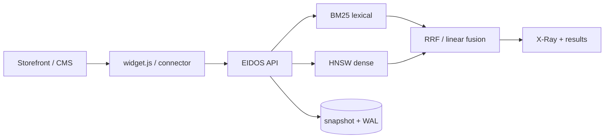

<div align="center">

# EIDOS

**Self-hosted hybrid search for e-commerce**

Lexical (BM25) + dense (HNSW, 384-d) + RRF · Explainable ranking · Bitrix & WooCommerce

[](https://github.com/ppiiyo/EIDOS/actions/workflows/ci.yml)
[](./LICENSE)
[](./package.json)
[](./package.json)

[Landing](https://eidos-landing-ppiiyo.vercel.app) ·
[Studio](https://eidos-demo.vercel.app) ·
[API demo](https://eidos-semantic-ideation-platform.ai.studio/) ·
[Pilot guide](./docs/PILOT.md) ·
[API reference](./docs/API.md)

</div>

---

## Why EIDOS

Most storefront search is either **keyword-only** (misses intent) or a **hosted SaaS** (data and cost outside your control). EIDOS is an open-source engine you run next to the shop:

| Capability | What you get |
|------------|----------------|
| **Hybrid retrieval** | BM25+ for SKU/brand/title · HNSW for natural language |
| **Fusion** | RRF or linear blend; weights tunable without redeploy |
| **X-Ray** | Per-hit explanation (dense / sparse / business signals) |
| **CMS packages** | 1C-Bitrix and WooCommerce connectors + storefront widget |
| **Ops model** | Docker, snapshot + WAL, API keys / roles, Prometheus metrics |

Embeddings run **on CPU by default** — no required OpenAI or GPU bill for the default path.

**Status:** pilot-ready core (search API, persistence, auth, connectors, widget, CI). This is not a claim of full parity with Algolia/Constructor enterprise merchandising suites.

---

## Live demos

| Surface | URL | Role |
|---------|-----|------|
| **Landing** | [eidos-landing-ppiiyo.vercel.app](https://eidos-landing-ppiiyo.vercel.app) | Product page + live demo search |
| **Studio** | [eidos-demo.vercel.app](https://eidos-demo.vercel.app) | Full UI (Studio / Admin); `/v1/*` proxied to the API host |
| **API host** | [ai.studio](https://eidos-semantic-ideation-platform.ai.studio/) | Long-running search process + persistence |

Try the public demo endpoint (no API key):

```bash
curl -s -X POST https://eidos-demo.vercel.app/v1/demo/search \
  -H 'Content-Type: application/json' \
  -d '{"query":"наушники для бега","topK":5}' | jq '.results[:3] | .[] | {title, price, brand}'
```

> Marketing sites call **`/v1/demo/search` on the same origin**; Netlify/Vercel rewrite `/v1/*` to the API host so browsers are not blocked by CORS. Details: [docs/LANDING.md](./docs/LANDING.md).

---

## Quick start

### Option A — Pilot script (~15–30 min)

```bash
git clone https://github.com/ppiiyo/EIDOS.git
cd EIDOS
chmod +x deploy/pilot/install.sh
./deploy/pilot/install.sh

curl -s http://localhost:3001/v1/ready
```

Keys and notes are written under `.env.pilot` (see script output).

### Option B — Docker Compose

```bash
cp .env.example .env   # if present; otherwise create .env
# Required (≥24 characters each):
#   EIDOS_MASTER_KEY=...
#   JWT_SECRET=...

corepack enable && pnpm install
docker compose up --build -d

curl -s http://127.0.0.1:8080/v1/health/ready
```

API listens on **8080** inside the stack (mapped as in `docker-compose.yml`). OpenAPI UI: `/docs` when the server is up.

### Option C — Local Node (development)

```bash
corepack enable
pnpm install
pnpm --filter @eidos/core build && pnpm --filter @eidos/sdk build
pnpm dev    # unified server (see package.json)
pnpm lint && pnpm test
```

---

## Connect a store

1. **Import catalog** — CSV/JSON ([CSV contract](./docs/CSV_CONTRACT.md)), YML (`POST /v1/catalog/import-yml`), or CMS sync  
2. **1C-Bitrix** — `pnpm pack:bitrix` → module under `packages/connectors/bitrix` / `connectors/bitrix`  
3. **WooCommerce** — `pnpm pack:woo` → `connectors/woocommerce`  
4. **Storefront widget**

```html
<script
  src="https://YOUR_EIDOS_HOST/widget.js"
  data-api="https://YOUR_EIDOS_HOST"
  data-key="YOUR_SEARCH_KEY"
  defer
></script>
```

Step-by-step: **[docs/PILOT.md](./docs/PILOT.md)** · no-code notes: [docs/PILOT_NO_CODE.md](./docs/PILOT_NO_CODE.md).

---

## Architecture

```
apps/api              Fastify API, VectorStore, auth, demo sandbox
apps/workspace        React Studio + Admin (Vite)
packages/core         HNSW / BM25 / ranking / fusion
packages/sdk          TypeScript client
packages/sdk/python   Python client
packages/connectors   Bitrix & WooCommerce modules
public/widget.js      Storefront embed (keep in sync with workspace copy)
landing/              Static product site
```

**Persistence:** disk snapshot applied **before** WAL replay; readiness gate so readers do not see a half-loaded store. The **demo tenant is ephemeral** and does not mutate production `default:default`.

**Security (high level):** API keys with roles (`master`, `admin`, `merchandiser`, `search`), JWT revocation, rate limits, strict CORS (`CORS_ORIGIN`), CSP, XXE-safe YML parsing, SSRF guards on URL import. See [SECURITY.md](./SECURITY.md).



---

## Configuration (essentials)

| Variable | Purpose |
|----------|---------|
| `EIDOS_MASTER_KEY` | Master API key (≥24 chars in production) |
| `JWT_SECRET` | JWT signing secret (≥24 chars) |
| `CORS_ORIGIN` | Comma-separated allowed origins (default includes local Studio) |
| `EIDOS_EMBEDDING_MODE` | Default `deterministic` for CPU-stable demos/CI |
| `EIDOS_ENABLE_DEMO_MUTATIONS` | Must be `true` to allow demo catalog load/reset on a host |
| `PORT` | API port (default `8080` in container images) |

Full ops: [docs/PRODUCTION.md](./docs/PRODUCTION.md) · monitoring: [docs/MONITORING.md](./docs/MONITORING.md).

---

## API surface (common)

| Method | Path | Notes |
|--------|------|--------|
| `POST` | `/v1/search` | Hybrid search + optional explanation |
| `POST` | `/v1/demo/search` | Isolated demo index (public demos) |
| `POST` | `/v1/recommend` | Item / adaptive strategies |
| `POST` | `/v1/catalog/upsert` | Admin-authenticated upsert |
| `GET` | `/v1/health`, `/v1/ready` | Liveness / readiness |
| `GET` | `/metrics` | Prometheus (auth may be required in production) |

OpenAPI: `/docs` on a running API. Reference: [docs/API.md](./docs/API.md).

---

## Development & CI

```bash
corepack enable && pnpm install   # lockfile: pnpm-lock.yaml (Fastify 4 / swagger@8)
pnpm --filter @eidos/core build
pnpm --filter @eidos/sdk build
pnpm lint
pnpm test
pnpm benchmark                    # optional local harness
pnpm pack:bitrix && pnpm pack:woo
```

**CI** (`.github/workflows/ci.yml`) runs on every push/PR to `main`:

| Job | What |
|-----|------|
| Lint, typecheck & build | `pnpm install --frozen-lockfile`, workspace builds |
| Full test suite | Node **20** and **22** |
| Core coverage | Node 20 |
| PHP connectors | lint, Bitrix autoload, PHPUnit, pack scripts |
| Python SDK | pytest |
| Production gate | smoke / audit tests |

---

## Deploy static landing

```bash
# Netlify (publish = landing via netlify.toml)
npx netlify deploy --dir=landing --prod

# Or one-click
# https://app.netlify.com/start/deploy?repository=https://github.com/ppiiyo/EIDOS
```

Vercel Studio app: [docs/VERCEL_DEMO.md](./docs/VERCEL_DEMO.md). Landing CORS/proxy notes: [docs/LANDING.md](./docs/LANDING.md).

---

## What we do **not** claim without your numbers

- Fixed **sub-15 ms p95** at 50k–100k SKU on arbitrary VPS sizes  
- Feature parity with every **hosted** merchandising / A-B suite  
- Cross-encoder quality unless that path is enabled and measured on your catalog  

Measure on your hardware: `pnpm benchmark`, `load-testing/`, and `/metrics`.

---

## Documentation map

| Doc | Contents |
|-----|----------|
| [QUICKSTART.md](./docs/QUICKSTART.md) | Short path to first search |
| [PILOT.md](./docs/PILOT.md) | Client pilot checklist |
| [PRODUCTION.md](./docs/PRODUCTION.md) | Keys, snapshots, runbook |
| [CSV_CONTRACT.md](./docs/CSV_CONTRACT.md) | Import validation rules |
| [INTEGRATION.md](./docs/INTEGRATION.md) | CMS / widget integration |
| [MIGRATION.md](./docs/MIGRATION.md) | Moving from other search stacks |
| [ARCHITECTURE.md](./docs/ARCHITECTURE.md) | Deeper design notes |
| [RETRIEVAL.md](./docs/RETRIEVAL.md) | Ranking / fusion behaviour |
| [BENCHMARKS.md](./docs/BENCHMARKS.md) | How we measure |
| [ROADMAP.md](./docs/ROADMAP.md) | Planned work |
| [CONTRIBUTING.md](./CONTRIBUTING.md) | How to contribute |
| [SECURITY.md](./SECURITY.md) | Vulnerability reporting |

---

## License

[MIT](./LICENSE) © Eidos Team
