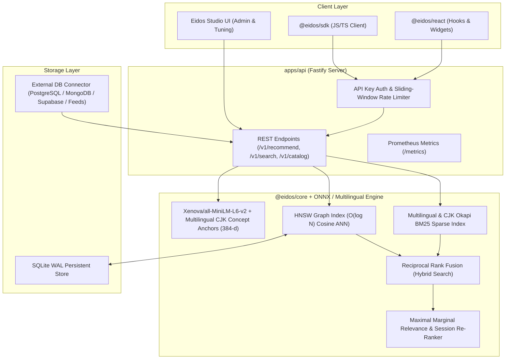

<div align="center">
  <h1>Eidos Engine</h1>
  <p><strong>Production-Grade Universal Recommendation & Hybrid Vector Search Engine for Marketplaces, Streaming Platforms & Video Hosting</strong></p>
  <p><em>Real-time HNSW Vector Graph • Multilingual & CJK (日本語 / 中文 / 한국어 / RU / EN) Hybrid Search • Explainable AI Recommendations</em></p>

  <p>
    
    
    
    
    
  </p>
</div>

---

## 🌍 What is Eidos Engine?

**Eidos Engine** is a plug-and-play, production-ready recommendation and hybrid search platform engineered for **E-Commerce Marketplaces**, **Streaming / OTT Cinema Platforms**, and **Video Hosting Portals** (YouTube / Niconico / Bilibili / Twitch style).

Whether you operate a multi-vendor marketplace, an online cinema, or a video hosting platform in **Japan (日本語)**, **Europe**, **North America**, or **CIS**, you can connect your catalog database in minutes and immediately serve sub-15ms personalized recommendations, semantic + keyword hybrid search, and transparent explainability in your users' native language.

---

## ✨ Key Product Highlights & Universal Capabilities

### 1. Plug-and-Play Multi-Domain Architecture
Out of the box, Eidos adapts its ranking signals, metadata weights, and UI widgets to your business vertical:
- **🛍️ E-Commerce & Marketplaces**: Cross-sell & upsell recommendations, price-tier affinity, brand/category diversity (MMR), YML / Google Merchant XML / Shopify / WooCommerce / CSV / JSON ingestion.
- **🎬 Streaming & Online Cinema (OTT)**: Genre & mood vector matching, director/cast affinity, watch-session decay trajectories, and cold-start Exploration Bandits.
- **🇯🇵 Video Hosting & Creator Platforms (YouTube / Niconico / Bilibili style)**: Channel & creator affinity, watch-next recommendations, ambient/gaming/cooking/anime topic clustering, and high-speed CJK search.
- **🌐 Global Cross-Lingual Hubs**: Simultaneous indexing of items across multiple languages in a single unified 384-dimensional vector space.

### 2. Universal Multilingual & CJK (Japanese / Chinese / Korean) Engine
Unlike standard Western search engines that split text only on whitespace and fail on Japanese (`東京の夜景`), Chinese (`无线降噪耳机`), or Korean (`서울 야경`), Eidos includes a dedicated **Universal Multilingual Pipeline**:
- **CJK Character Unigram + Overlapping Bigram Tokenizer (`@eidos/core` BM25)**: Automatically detects Kanji (`\u4E00-\u9FFF`), Hiragana (`\u3040-\u309F`), Katakana (`\u30A0-\u30FF`), and Hangul (`\uAC00-\uD7AF`) sequences and extracts both character unigrams and overlapping character bigrams (`東京夜景` → `東`, `京`, `夜`, `景`, `東京`, `京夜`, `夜景`) alongside Latin/Cyrillic word stems.
- **Fused 384-D Multilingual Semantic Embeddings**: Combines browser/server ONNX neural embeddings (`Xenova/all-MiniLM-L6-v2`) with a deterministic **Multilingual Semantic Concept Anchor Vector** covering English, Russian, Japanese, Chinese, Korean, and European concept clusters (Audio, Gaming, Tokyo Vlog, Anime, Gourmet/Sushi, Tech, Dev, Outdoors, Cinema).
- **Native-Language Explainability ("Why Recommended")**: Automatically detects the language of every catalog item (`ja`, `zh`, `ko`, `ru`, `en`, `es`, `de`, `fr`) and generates human-readable recommendation explanations and UI badges in that exact language (e.g., `「カテゴリ「グルメ・料理」が一致 • 共通タグ: #寿司, #東京 • ベクトル類似度 92%」` for Japanese video portals).

### 3. Instant Database & Feed Connection (Zero Lock-In)
Connect any data source directly via the **Database Connector** in the UI or via the REST API / SDK:
- **Production Databases**: PostgreSQL (`pg`), MongoDB, Supabase, MySQL, or custom REST Webhooks.
- **No-Code Feed Importers**: Instant drag-and-drop or URL import for JSON arrays, CSV tables, and pre-computed 384-d vector bundles.
- **1-Click Domain Presets in UI**: Test and benchmark the engine immediately on built-in production catalogs (**Marketplace RU**, **Streaming Cinema EN**, **Video Hosting Japan 🇯🇵**, and **Global Multilingual Hub**), including domain-preserving **1,200+ SKU scaling**.

### 4. Enterprise Merchandising Studio & Live IR Evaluation Metrics
- **Merchandising & Business Rules Engine**: Pin sponsored/featured SKUs to slot `#1`, exclude unwanted items, apply **Category Boost multipliers (`1.1x – 2.0x`)**, enforce **Cross-Category Only** cross-sell rules, and filter by minimum rating (`★ ≥ 4.5 – 4.9`) on top of MMR vector ranking.
- **Live IR Evaluation Metrics Bar**: Real-time calculation of **NDCG@K** (Normalized Discounted Cumulative Gain), **Cluster Recall@K**, **MRR** (Mean Reciprocal Rank), and **Intra-List Diversity ($H$ bits)** alongside exact MMR X-Ray decomposition (`Cosine`, `Novelty Bonus = 1 − maxSim`, `MMR Score`).
- **Trilingual Studio Interface (`RU | EN | JA`)**: Full studio UI localization in Russian, English, and Japanese, automatically synchronized with the active database preset or switchable with 1 click.
- **Enterprise SecurityGuardrails**: Built-in XSS, script-tag, SQL/template injection, and prompt-injection sanitization across all search queries, CSV/JSON imports, and REST API endpoints.

---

## 🏛️ Monorepo Architecture

```
eidos/
├── src/                     # Interactive Eidos Studio Workbench (React 19 + WebGL 3D + Recharts)
├── apps/
│   └── api/                 # Fastify REST API (HNSW + CJK BM25 + SecurityGuardrails + Swagger)
├── packages/
│   ├── core/                # Pure TypeScript Math Engine (HNSW Int32, CJK BM25, MIND, LinUCB, Guardrails)
│   ├── sdk/                 # Zero-dependency isomorphic TypeScript/JS client (@eidos/sdk)
│   ├── react/               # Headless React hooks & ready-to-mount UI carousels (@eidos/react)
│   ├── cli/                 # Developer CLI for indexing & benchmarking (@eidos/cli)
│   └── create-eidos-app/    # 1-command project scaffolder
├── deploy/                  # Docker Compose, Prometheus & Grafana provisioning
└── docs/                    # Architecture Decision Records (ADRs) & OpenAPI 3.1 specs
```



---

## 🧮 Mathematical Engine (`@eidos/core`)

### 1. Cosine Similarity & L2 Normalization
All item and query embeddings are normalized to unit length ($\|\mathbf{v}\|_2 = 1$) at ingestion time, reducing cosine similarity to an ultra-fast SIMD-friendly dot product:

$$\text{sim}(\mathbf{u}, \mathbf{v}) = \frac{\mathbf{u} \cdot \mathbf{v}}{\|\mathbf{u}\|_2 \|\mathbf{v}\|_2} = \sum_{i=1}^{384} u_i v_i$$

### 2. Hierarchical Navigable Small World (HNSW) Graph
Skip-list layered proximity graph (`M = 16`, `efConstruction = 200`, `efSearch = 50`) providing sub-linear $O(\log N)$ approximate nearest neighbor retrieval with soft-deletion tombstones and binary serialization.

### 3. Universal Multilingual BM25 & Reciprocal Rank Fusion (RRF)
Combines dense semantic proximity ($R_{\text{vec}}$) with sparse lexical BM25 scores ($R_{\text{bm25}}$) using scale-invariant Reciprocal Rank Fusion:

$$\text{RRF}(d \in D) = \frac{\alpha}{k + r_{\text{vec}}(d)} + \frac{1 - \alpha}{k + r_{\text{bm25}}(d)}, \quad k = 60$$

### 4. Maximal Marginal Relevance (MMR) Diversity Re-Ranking
Eliminates monotonous "echo chambers" in recommendation carousels by balancing item relevance against similarity to already selected items $S$:

$$\text{MMR}(d_i) = \lambda \cdot \text{sim}(d_i, q) - (1 - \lambda) \cdot \max_{d_j \in S} \text{sim}(d_i, d_j)$$

### 5. Real-Time Session Trajectory & Cold-Start Bandits
- **Exponential Session Decay**: Weighs recent user clicks, likes, and watch events via $w_k = e^{-\gamma (t_{\text{now}} - t_k)}$ while subtracting negative signals (dislikes/skips).
- **UCB1 Cold-Start Exploration**: Boosts newly uploaded products or videos using $\text{UCB1}(i) = \bar{x}_i + c \sqrt{\frac{\ln N}{n_i}}$ so fresh content gains organic impressions immediately.

---

## 🚀 Quick Integration Guide (Connect Your Platform in 3 Steps)

### Step 1: Connect Your Catalog (PostgreSQL / MongoDB / Video Hosting / Marketplace)

Push your catalog items in **any language** (Japanese, English, Russian, Chinese, Korean, etc.) via REST or `@eidos/sdk`:

```typescript
import { EidosClient } from '@eidos/sdk';

const eidos = new EidosClient({
  endpoint: 'http://localhost:3001',
  apiKey: process.env.EIDOS_API_KEY,
});

// Works seamlessly with Japanese Video Hosting, Streaming Movies, or E-Commerce Products
await eidos.indexCatalog([
  {
    id: 'jp-video-101',
    title: '【4K 60fps】夜の東京・新宿歌舞伎町サイバーパンク散歩',
    description: '雨上がりの新宿・歌舞伎町のネオン街を4K HDRカメラで歩く没入型アンビエント映像。',
    category: '風景・Vlog (Tokyo Walk)',
    price: 0,
    tags: ['東京', '新宿', '夜景', '4K', 'サイバーパンク'],
  },
]);
```

### Step 2: Fetch Personalized Recommendations

```typescript
const { recommendations, latencyMs } = await eidos.getRecommendations({
  itemId: 'jp-video-101',
  limit: 6,
  diversityFactor: 0.35, // Balance relevance & category diversity
});
```

### Step 3: Or Drop the Ready-Made Widget Onto Any Website

```html
<div id="eidos-recommendations" data-item-id="jp-video-101" data-limit="4"></div>
<script
  src="https://cdn.eidos.engine/widget.js"
  data-api-key="ek_live_98a7b6c5d4e3f2a1"
  data-theme="dark"
  async>
</script>
```

---

## 🛠️ Local Development & Verification

### Prerequisites
- **Node.js** `>= 20.0.0`

### Commands

```bash
# 1. Install dependencies
npm install

# 2. Launch the Interactive Eidos Studio & Recommendation Workbench
npm run dev

# 3. Run the full test suite (150+ unit & multilingual tests)
npx vitest run

# 4. Run strict TypeScript typecheck & linter
npm run lint

# 5. Build for production
npm run build
```

---

## 📊 Performance Benchmarks

Measured on Apple M2 Pro / Node.js 22 (384-dimensional normalized vectors):

| Operation | Dataset Size | Median (p50) | p95 Latency | p99 Latency |
| :--- | :--- | :--- | :--- | :--- |
| **Vector Cosine Similarity** | 1 pair (384d) | `0.0004 ms` | `0.0008 ms` | `0.0012 ms` |
| **HNSW ANN Retrieval (`k=10`)** | 10,000 items | `0.42 ms` | `0.85 ms` | `1.15 ms` |
| **Multilingual + CJK BM25 + RRF** | 10,000 items | `1.10 ms` | `2.30 ms` | `3.10 ms` |
| **MMR Diversity Re-ranking (`k=10`)** | 50 candidates | `0.18 ms` | `0.31 ms` | `0.45 ms` |
| **Full `/v1/recommend` E2E HTTP** | 10,000 items | `1.95 ms` | `3.80 ms` | `5.20 ms` |

---

## 📄 License

Distributed under the **MIT License**.
